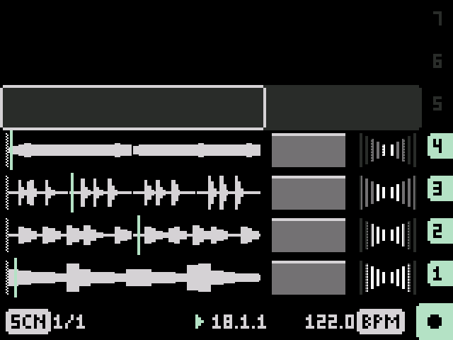
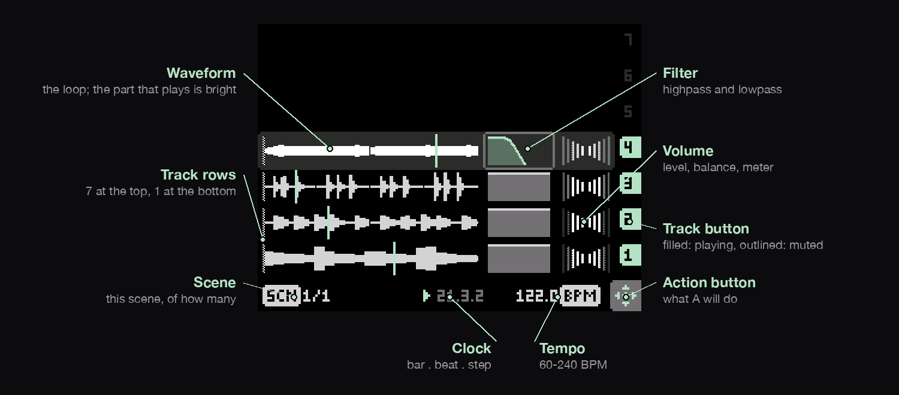
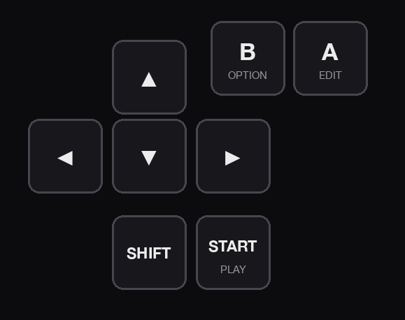
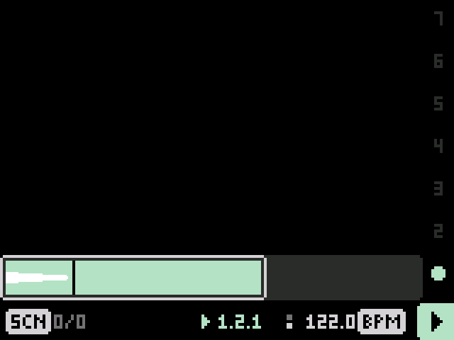
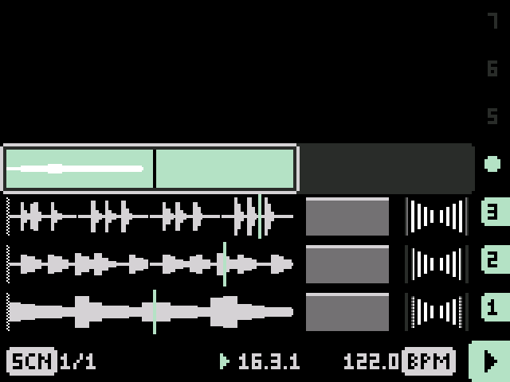
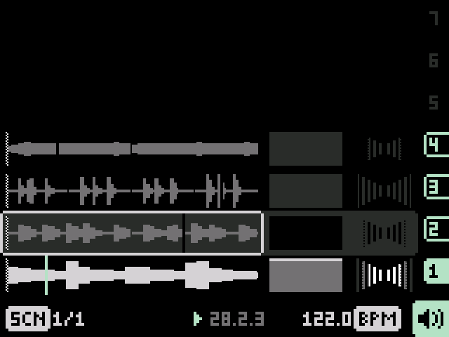
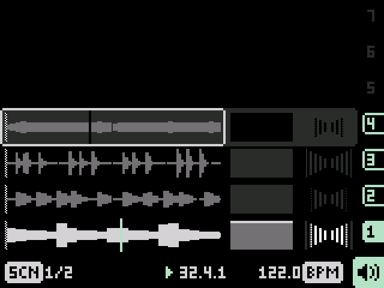
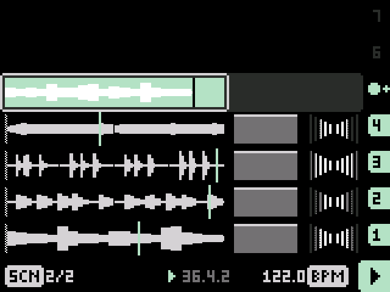
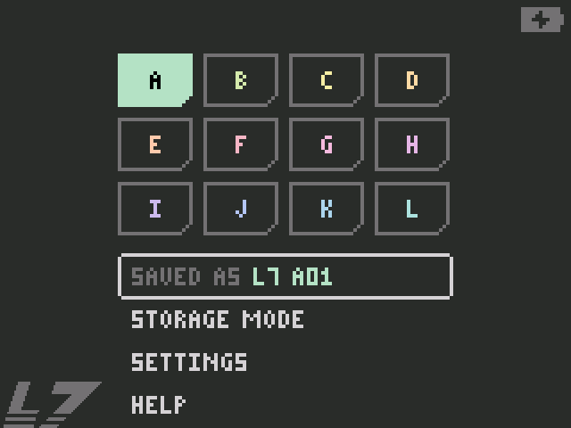

<h1><picture>
  <source media="(prefers-color-scheme: dark)" srcset="docs/readme/l7-logo.svg">
  
</picture></h1>

A 7-track stereo looper firmware for the **Dirtywave M8 Model:01**. Record loops from the line input, layer
them as 1 to 32-bar loops, shape and mix them, keep combinations as scenes, and export a whole project to Ableton Live.

**[Download the latest release](https://github.com/minusro/L7/releases/latest)** ·
[User guide (PDF)](docs/L7%20User%20Guide.pdf) ·
[Cheatsheet (PDF)](docs/L7%20Cheatsheet.pdf)

> **Model:01 only.** L7 is built for the Model:01's Teensy 4.0 board and its
> 320×240 screen. It doesn't run on the Model:02.

## Installing

1. Download `L7-v….hex` from the [latest release](https://github.com/minusro/L7/releases/latest).
2. Connect the M8 to your computer over USB and switch it on.
3. Flash the `.hex` the way you'd install a Dirtywave firmware update: open it
   in [Teensy Loader](https://www.pjrc.com/teensy/loader.html) (or TyUploader)
   and let it program the M8.

L7 keeps everything on the SD card under `/L7` (projects, recordings,
exports). To go back to the M8's own firmware, flash Dirtywave's firmware the
same way.

## The screen

Seven track rows, 7 at the top and 1 at the bottom, then the status row. Each
track has a **waveform**, a **filter** and a **volume** cell, and a button on
the right. The selected cell has a light frame; move it with the arrows. The
**action button** at the bottom right always shows what **A** will do.

## The keys

| Keys | What they do |
|---|---|
| Arrows | Move the selection |
| **A** | Record on an empty track; mute / unmute a track with a clip |
| **B** held + arrows | Adjust the selected cell |
| **B** twice | Reset the cell |
| **SHIFT** + UP / DOWN | Previous / next scene |
| **START** | Play from 1.1.1 / stop |
| **B** + **A** on an empty track | Resample what you hear |
| Arrow past the screen's edge | Open the menu |

 

## Quick guide

<table>
<tr>
<td width="50%"></td>
<td width="50%"></td>
</tr>
<tr>
<td><b>1. Record a loop.</b> Plug your source into the line input; it's always heard. Select an empty track and press <b>A</b>: the clock starts and recording begins on bar 1. Press <b>A</b> again to stop. Loops are always whole bars (up to 32), and play on as soon as they're done, with no gap.</td>
<td><b>2. Layer it.</b> Record on another empty track while the others play: it starts on the next bar line. Loops of different lengths play together in time. Pressing <b>A</b> on another empty track while one records queues the next one to start right where the first ends.</td>
</tr>
<tr>
<td></td>
<td></td>
</tr>
<tr>
<td><b>3. Shape and mix.</b> Hold <b>B</b> and use the arrows: on the waveform, move and resize the range that plays; on the filter, move and widen the band; on the volume cell, level and balance. <b>B</b> twice resets the cell. <b>A</b> mutes a track; keep <b>A</b> held and press UP / DOWN to swipe the mute across tracks.</td>
<td><b>4. Scenes.</b> A scene is a snapshot of all seven tracks, saved as you go. <b>SHIFT</b> + UP / DOWN steps through them, switching on the next beat; while you hold <b>SHIFT</b> the screen shows the scene you've picked. <b>SHIFT</b> + <b>B</b> twice duplicates the scene, ready to change.</td>
</tr>
<tr>
<td></td>
<td></td>
</tr>
<tr>
<td><b>5. Resample.</b> Hold <b>B</b> and press <b>A</b> on an empty track to record what you hear, every track as it sounds, as a new loop you can layer over.</td>
<td><b>6. Projects and export.</b> Press an arrow past the screen's edge to open the menu: 12 projects (A–L), each with its own scenes and tempo. <b>EXPORT ABLETON SET</b> writes the project to the card as a Live 11 set, every scene and clip; <b>STORAGE MODE</b> mounts the card on your computer.</td>
</tr>
</table>

### Tempo and sync

Select the tempo cell and hold **B**: LEFT / RIGHT ±0.1 BPM, UP / DOWN ±1
(60–240 BPM); press **A** there to tap the tempo. Changing the tempo keeps the
loops' pitch: they're time-stretched. L7 follows a MIDI clock (the MIDI in, or USB),
sends its own, and can follow the beat of audio coming in (**SHIFT** + **A** on
the tempo cell). Over USB the M8 is also an audio interface: the mix and each
track on its own channels.

The [user guide](docs/L7%20User%20Guide.pdf) has everything else; the
[cheatsheet](docs/L7%20Cheatsheet.pdf) fits on one page.

## Building from source

Teensyduino with a patched core (for storage mode and USB audio and MIDI), a
simulator for the engine, and the tools behind the demo video and these
pictures: see [docs/build-and-test.md](docs/build-and-test.md).

## License

L7 is free software: © 2026 Daniel Stanciu, released under the
[GNU General Public License v3.0](LICENSE). You can use, study, change and share
it; changed versions you share must stay under the same license, with their
source.
